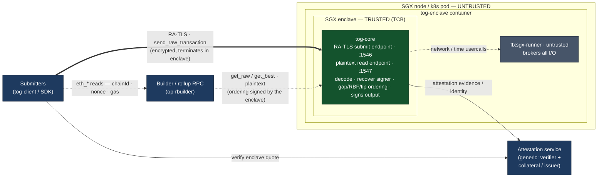

# Transaction Order Guarantor — SGX / Fortanix EDP

Runs the **transaction ordering** (the mempool) inside an Intel SGX enclave as
the smallest trusted unit. Clients send transactions **directly to the enclave**
— there is intentionally **no proxy in the ingestion path** (censorship
resistance) — and query the builder directly for read-only `eth_*`. One input
(`send_raw_transaction`) terminates inside the enclave; two outputs
(`get_raw_transactions`, `get_best_transaction_hashes`) are read from it.

**Attestation is currently a dev stub** and the transport is **plaintext** (even
inside a real enclave). A real attested transport is future work — see
[Attestation](#attestation).

## Showstoppers / things you must provide (read first)

1. **No SGX on an Apple-Silicon Mac.** arm64 has no SGX hardware and there is no
   Fortanix software simulator. You can *edit* and run the plaintext dev path,
   but you **cannot build the enclave for SGX or run it** there. Provision a
   **Linux x86_64 host with SGX2** — easiest is an **Azure confidential VM**
   (DCsv3 / DCdsv3, Ice Lake; large EPC), or bare-metal Ice Lake / Sapphire
   Rapids Xeon. Avoid SGX1 (tiny ~93 MB EPC). Note: **building** the enclave
   image needs only the toolchain (no SGX HW); SGX HW is needed to **run** it.
2. **The reth `OpTransactionPool` cannot go in the enclave.** It transitively
   pulls in Tokio/mio + C dependencies (`c-kzg`, secp256k1-C, mdbx, …). The
   `x86_64-fortanix-unknown-sgx` target cannot compile C via the `cc` crate, so
   that whole stack won't link inside an enclave. The minimal tip ordering is
   therefore **reimplemented in pure Rust** in `crates/tog-core`.
3. **Rust nightly is required** by Fortanix EDP (`rustup target add … --toolchain
   nightly`).
4. **You install the SGX driver + Fortanix tools on the Linux host yourself**
   (see [Build-host setup](#build-host-setup-linux-sgx-box)). PSW/AESM/DCAP are
   only needed once a real attested transport is added.
5. **In-enclave time is untrusted and the pool is volatile.** `SystemTime` is a
   host usercall (host can lie); enclave memory is wiped on restart (no sealing
   yet). Fine for an ephemeral mempool — just know it.

## Architecture

End-state architecture — **submission over RA-TLS terminating inside the
enclave**; the builder reads the (enclave-**signed**) ordering over **plaintext**,
no TLS. (Today both endpoints are plaintext and the attestation is a dev stub;
see [Attestation](#attestation).)



Edge legend: **⇒ thick** = RA-TLS, encrypted + attested — **only the submission
path** · **→ solid** = attestation (submitters verify the enclave before trusting
the submit channel) · **⇢ dotted** = plaintext — the builder's read of the
**enclave-signed** ordering, the submitter's `eth_*` reads, and the enclave's
network/time usercalls.

**Boundaries & limits**

* **TCB = `tog-core` inside the enclave only** (green): the RA-TLS submit endpoint
  + decode + signer recovery + ordering + **signing the output**. Nothing else is
  trusted.
* **Two endpoints, two transports.** Submission (`send_raw_transaction`, `:1546`)
  is **RA-TLS that terminates inside the enclave**, so the untrusted
  `ftxsgx-runner` brokers the socket but sees **only ciphertext** — it can't read,
  selectively drop, reorder or inject txs. The builder's reads (`get_raw` /
  `get_best`, `:1547`) are **plaintext**, so the runner *does* see — and could
  tamper with — them; integrity there comes from the enclave **signing** its
  output (the builder verifies the signature against the enclave's attested key),
  making the plaintext read **tamper-evident without TLS**.
* **Why the asymmetry**: submission must be confidential *and* censorship-resistant
  against the untrusted host → encrypted + attested. The builder only *consumes*
  the committed ordering, which isn't secret; its integrity is protected by the
  signature, not the transport → it needs no TLS.
* **Direct to the enclave, no proxy** (censorship resistance): tx submission goes
  straight to the enclave; submitters hit the **builder / rollup RPC directly** for
  read-only `eth_*` (chainId, nonce, gas), which never touches the ordering.
* **Attestation is generic**: submitters verify the enclave's identity (a quote
  bound to its TLS key) before trusting the submit channel; the builder relies on
  the signed ordering instead. The mechanism (managed issuer vs DCAP + collateral)
  is intentionally left open.
* **Hard limits**: enclave heap is bounded by node **EPC** (`heap-size`, default
  2 GiB → needs SGX2); the pool is **ephemeral** (lost on restart) and in-enclave
  **time is untrusted**.

> Status: signing the ordering, the two-port split, and the RA-TLS submit channel
> are **future work** — today there's one plaintext port and a dev stub
> attestation. RA-TLS-with-stub (TLS termination + a non-verifying client, before
> real quotes) is the planned next step on the submit path.

### Crates

| crate         | target                         | role |
|---------------|--------------------------------|------|
| `tog-proto`   | any (pure)                     | length-prefixed JSON wire protocol (3 ops + stub attestation) |
| `tog-core`    | any (pure)                     | **TCB**: decode + signer recovery + tip ordering, unit-tested |
| `tog-enclave` | `x86_64-fortanix-unknown-sgx`  | client listener (no Tokio), dispatches to `tog-core` |
| `tog-client`  | normal                         | test/reference client (+ dev stub attestation) |

Read-only `eth_*` is **not** proxied — clients call the builder directly, so no
untrusted component sits in the ingestion path.

### No-Tokio model

The enclave uses blocking `std::net` + one OS thread per connection. SGX threads
are preallocated (`threads` in `crates/tog-enclave/Cargo.toml`
`[package.metadata.fortanix-sgx]`), so that number caps concurrent connections.
No async runtime is needed or wanted — it shrinks the TCB and avoids mio (which
doesn't target SGX cleanly).

### Ordering & nonce model (no chain state)

The enclave never sees on-chain account state, and doesn't need it to *order*
transactions. [`tog-core::Mempool`](crates/tog-core/src/mempool.rs):

* **per-sender sequencing** — only the contiguous nonce run from an anchor is
  "ready"; anything past a gap is held until it fills,
* **replace-by-fee** — `(sender, nonce)` collisions collapse to the higher tip,
* **cross-sender priority** — ready heads merged greedily by effective tip.

The anchor is the lowest nonce seen, unless an on-chain nonce is supplied via
`Mempool::set_account_nonce` — an untrusted hint that only refines readiness
(final validity is enforced by the builder when it executes the ordering, so a
wrong hint can at worst make the ordering suboptimal, never unsafe). This
replaces the old "fake the account nonce per tx" trick and needs no
state-provider abstraction.

> Note: `set_account_nonce` is currently an **in-enclave API only** — not yet
> exposed over the wire, so the enclave anchors on the lowest nonce it has seen.
> Wiring a hint channel is deferred: in the direct-to-enclave model the untrusted
> host never sees decrypted txs (hence not the senders), so a future hint would
> come from the builder's get-best request or an enclave-initiated
> `eth_getTransactionCount` call.

## Build & run

### Pure-Rust core + dev dataplane (works anywhere, incl. an arm64 Mac)

```bash
cargo test  -p tog-proto -p tog-core   # the logic that matters, verifiable locally
cargo run   -p tog-enclave             # submit :1546 + read :1547 (both plaintext in dev)
```

The enclave generates an ordering-signing keypair at load (printed at startup);
the read endpoint signs `get_best` with it.

### Test client (`tog-client`)

Talks to the submit endpoint (`--submit`, default `127.0.0.1:1546`) and the read
endpoint (`--read`, default `127.0.0.1:1547`):

```bash
# end-to-end smoke test (start the enclave first):
cargo run -p tog-client -- demo
#   → sends txs with tips 5/100/50 (submit); get-best returns 100,50,5 and the
#     client VERIFIES the signature against get-pubkey; get-raw drains.

cargo run -p tog-client -- send 0x02f8...   # submit a raw tx (submit endpoint)
cargo run -p tog-client -- get-best         # print ordering + verify the signature
cargo run -p tog-client -- get-pubkey       # the enclave's ordering-signing key
```

The plaintext `demo` (including signature verification) is verified working
end-to-end on an arm64 Mac.

#### Signed ordering (builder integrity without TLS)

`get_best_transaction_hashes` returns the ordering **plus an ECDSA signature**
over it. The enclave generates the secp256k1 signing key once at load (no
rotation) and exposes it via `get_public_key`; the builder verifies the signature
— so the read endpoint stays plaintext yet **tamper-evident** (the untrusted
runner can't alter the ordering undetected). Until attestation lands the key
itself isn't yet authenticated (a real quote would bind it) — that's the
remaining gap. The `demo` does this verification and prints `signature: VERIFIED`.

#### Submit-path TLS stub — feature `tls`

By default the submit endpoint is plaintext (dev). `--features tls` makes the
enclave terminate **TLS** there with a self-signed cert and the client connect
with `AuthMode::None` (cert **not** verified — the stub). That is RA-TLS minus the
quote; adding the quote to the cert + client-side quote verification is the only
remaining step to real attestation. It needs mbedtls (a C build → `cmake`), so
build it on the Linux box, not the Mac:

```bash
cargo build -p tog-enclave --features tls          # TLS submit endpoint (mbedtls)
cargo run   -p tog-client  --features tls -- demo  # TLS submit, plaintext reads
```

### Enclave (Linux SGX host, nightly)

```bash
rustup target add x86_64-fortanix-unknown-sgx --toolchain nightly
cargo install fortanix-sgx-tools sgxs-tools

cargo +nightly build --release -p tog-enclave --target x86_64-fortanix-unknown-sgx

# with the runner configured (see setup §5), this converts + signs + runs:
cargo +nightly run -p tog-enclave --target x86_64-fortanix-unknown-sgx
# …or do it by hand:
ftxsgx-elf2sgxs target/x86_64-fortanix-unknown-sgx/release/tog-enclave \
    --heap-size 2147483648 --stack-size 262144 --threads 16 --debug \
    --output tog-enclave.sgxs
sgxs-sign --key signing-key.pem tog-enclave.sgxs tog-enclave.sig
ftxsgx-runner tog-enclave.sgxs
```

The default build is plaintext (no TLS deps). Add `--features tls` for the TLS
submit endpoint (pulls mbedtls → needs `cmake`).

### Docker (build with no Rust on the host)

`Dockerfile.enclave` is multi-stage: the nightly toolchain + Fortanix tools live
in the build stage, so the build host needs **only Docker** (build it on any
x86_64 Linux, incl. CI — no SGX hardware needed just to *build*). Running needs
the kernel SGX driver passed in; on FLC hardware (which EDP requires) no AESM is
needed to launch. The submit endpoint is **TLS** (mbedtls compiled into the
`.sgxs`), so the client connects with `--features tls` (a plaintext client can't
speak to a TLS listener); the read endpoint stays plaintext.

```bash
docker build -f Dockerfile.enclave -t tog-enclave .

docker run --rm --device /dev/sgx_enclave -p 1546:1546 -p 1547:1547 tog-enclave
# then, from the same host:
cargo run -p tog-client --features tls -- demo
```

(EDP enclaves don't inherit the container env, so there are no `-e` knobs — the
binds and the ordering key are baked in / generated at load.) Docker isolates the
binary, not the silicon — SGX is hardware and can't be virtualized away; the
machine that runs the enclave needs the SGX device. On Kubernetes, deploy the
enclave with the SGX device-plugin EPC request and publish `:1546` (submit) +
`:1547` (read).

For local integration testing / CI **without SGX**, [`Dockerfile.enclave-dev`](Dockerfile.enclave-dev)
runs the enclave binary as a plain process (no SGX, no runner, plaintext) — stable
Rust, no Fortanix tools:

```bash
docker build -f Dockerfile.enclave-dev -t tog-enclave-dev .
docker run --rm -p 1546:1546 -p 1547:1547 tog-enclave-dev   # then: tog-client demo
```

It is **not** secure (no enclave, no attestation) — it's a convenience for
exercising the dataplane off-SGX.

## Build-host setup (Linux SGX box)

Ubuntu 22.04/24.04 x86_64. For the current (stub) mode you need steps 0–1 + 3–6;
step 2 (PSW/AESM/DCAP) is only for a real attested transport later. If you only
ever ship via Docker, steps 3–5 live in the image's build stage.

**0. Hardware / VM** — CPU with SGX **+ FLC**; for SGX2 / large EPC use Azure
DCsv3 / DCdsv3 (pre-enabled) or Ice Lake / Sapphire Rapids bare metal (enable SGX
in BIOS, not "software controlled"). Kernel ≥ 5.11.

**1. SGX driver** — kernel ≥ 5.11 is in-tree; verify `ls /dev/sgx_enclave
/dev/sgx_provision` and add yourself to the `sgx` group. Older kernels: install
Intel's out-of-tree DCAP driver (`/dev/isgx`).

**2. PSW + AESM** — *only needed for a real attested transport (future).* Use the
keyring method (`apt-key` is deprecated/removed on recent Ubuntu):
```bash
curl -fsSL https://download.01.org/intel-sgx/sgx_repo/ubuntu/intel-sgx-deb.key \
  | sudo gpg --dearmor -o /usr/share/keyrings/intel-sgx.gpg
echo "deb [signed-by=/usr/share/keyrings/intel-sgx.gpg] https://download.01.org/intel-sgx/sgx_repo/ubuntu $(lsb_release -cs) main" \
  | sudo tee /etc/apt/sources.list.d/intel-sgx.list
sudo apt-get update
# EDP requires FLC hardware, which does NOT need the legacy launch plugin
# (libsgx-aesm-launch-plugin) — installing it pins libsgx-urts to an older
# version and breaks the DCAP deps. Install the consistent runtime + DCAP set:
sudo apt-get install -y \
    libsgx-enclave-common libsgx-urts libsgx-pce-logic libsgx-qe3-logic \
    sgx-aesm-service libsgx-aesm-pce-plugin libsgx-aesm-ecdsa-plugin \
    libsgx-aesm-quote-ex-plugin libsgx-dcap-ql libsgx-dcap-default-qpl
```
Check `systemctl status aesmd` and `/var/run/aesmd/aesm.socket`. (Unrelated
`NO_PUBKEY` errors from other repos — e.g. a stale Yarn source — will fail
`apt-get update`; remove or re-key those sources first. If you still hit unmet
deps on `libsgx-pce-logic`/`libsgx-urts`, a stray `libsgx-aesm-launch-plugin` is
pinning an old `libsgx-urts` — `sudo apt-get remove -y libsgx-aesm-launch-plugin`,
re-run `apt-get update`, and reinstall the set above.)

**3. Build deps** (the C deps the Fortanix tools need + openssl for signing):
```bash
sudo apt-get install -y build-essential pkg-config libssl-dev protobuf-compiler
```

**4. Rust nightly + the EDP target:**
```bash
curl --proto '=https' --tlsv1.2 -sSf https://sh.rustup.rs | sh
rustup toolchain install nightly
rustup target add x86_64-fortanix-unknown-sgx --toolchain nightly
```

**5. Fortanix tools + cargo runner** — `cargo install fortanix-sgx-tools
sgxs-tools`, then add to `~/.cargo/config.toml`:
```toml
[target.x86_64-fortanix-unknown-sgx]
runner = "ftxsgx-runner-cargo"
```

**6. Verify the box:** `sgx-detect` (reports SGX enabled, driver, and whether it
can actually run an enclave).

## Attestation

The enclave currently has **no real attestation**: both endpoints are plaintext,
and it always presents a fake attestation document that `tog-client` reads (see
[Dev stub attestation](#dev-stub-attestation)). This is enough to develop and
integrate the end-to-end flow on real SGX.

Target (see [Architecture](#architecture)) — the paths are **asymmetric**:

* **Submission** is encrypted + attested: RA-TLS terminating inside the enclave,
  the SGX quote bound to the TLS key and verified by submitters.
* **Builder reads stay plaintext**: their integrity comes from the enclave
  **signing** the ordering (the builder verifies the signature against the
  enclave's attested key), so that path needs no TLS.

Because RA-TLS is just TLS with a quote-carrying self-signed cert, the planned
next step on the submit path is **TLS-with-stub-attestation**: stand up the
TLS-terminated-in-enclave channel with a self-signed cert and a **non-verifying
client** (`AuthMode::None`) — identical plumbing to RA-TLS, minus the quote — then
later add the quote to the cert and quote verification on the client to reach real
attestation. The transport seam is
[`crates/tog-enclave/src/transport.rs`](crates/tog-enclave/src/transport.rs)
(`Transport::init` / `Transport::accept` → a `Read + Write` `Session`), so it
slots in without touching `main.rs` or the protocol.

## Validate against your builder

`tog-core`'s ordering implements gap-aware per-sender sequencing, replace-by-fee
and greedy tip priority. Still **validate it against your builder's actual
selection** (base-fee handling, tie-breaks) before treating the output as a
guarantee. OP deposit txs (type `0x7E`) are not expected via
`send_raw_transaction` and are not handled.
